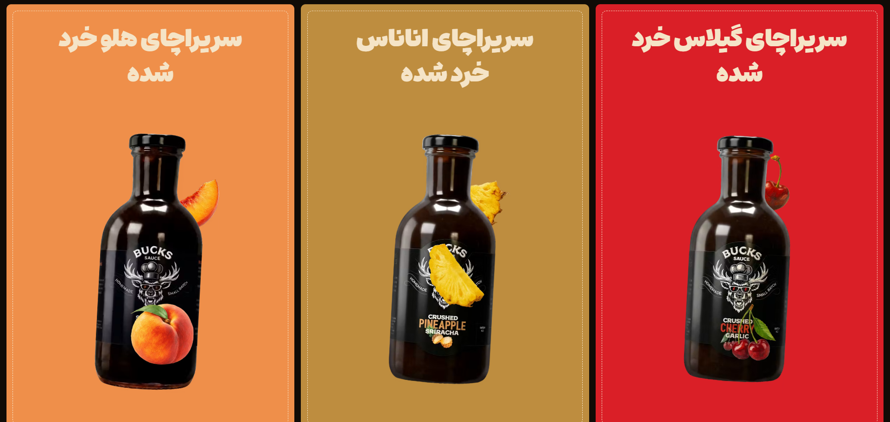
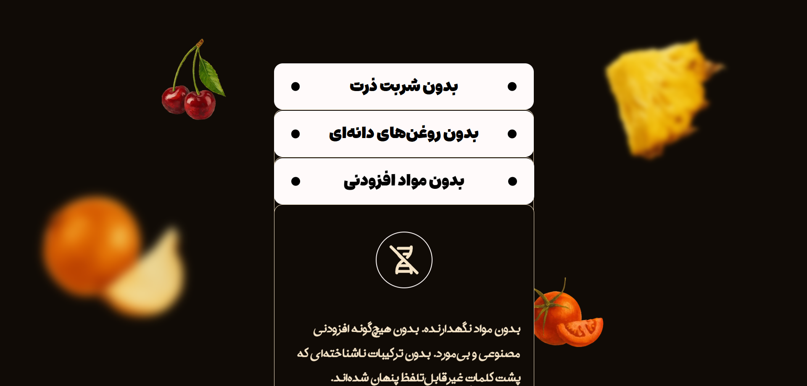
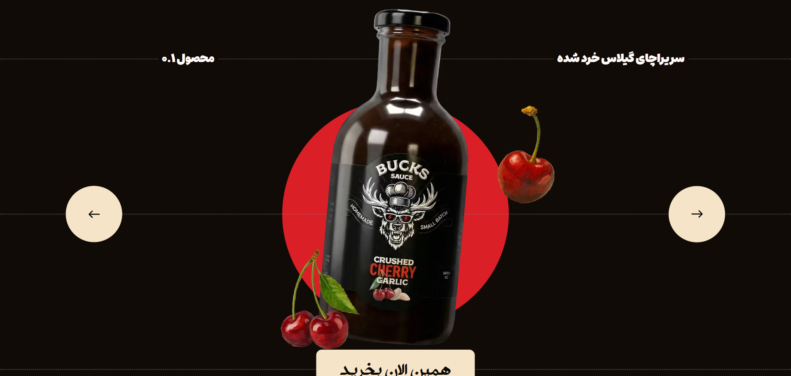
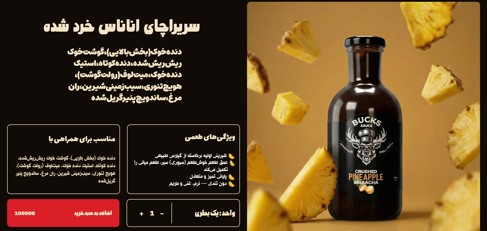

# Bucks Landing

یک وب‌سایت مدرن و تعاملی برای معرفی و نمایش محصولات برند **Bucks** که با تمرکز بر طراحی رابط کاربری، انیمیشن و تجربه کاربری ساخته شده است.

این پروژه به‌صورت یک **Product Landing Page** طراحی شده و شامل صفحه اصلی، صفحه اختصاصی محصولات و صفحه 404 است.

---

## پیش‌نمایش پروژه

در تصاویر زیر بخش‌های مختلف وب‌سایت را مشاهده می‌کنید.

### صفحه اصلی و نمایش محصولات

صفحه اصلی با کارت‌های رنگی محصولات، تصاویر بزرگ و چیدمان بصری متمایز طراحی شده است.



### بخش معرفی ویژگی‌های محصول

در این بخش، ویژگی‌ها و مزایای محصول با استفاده از کارت‌های محتوایی و تصاویر تزئینی نمایش داده می‌شوند.



### اسلایدر تعاملی محصولات

محصولات در یک اسلایدر تعاملی نمایش داده می‌شوند و کاربر می‌تواند بین آن‌ها جابه‌جا شود.



### صفحه اختصاصی محصول

برای هر محصول یک صفحه جداگانه در نظر گرفته شده که تصویر، توضیحات، ویژگی‌ها، قیمت و کنترل تعداد محصول را نمایش می‌دهد.



---

## ویژگی‌های پروژه

- طراحی مدرن و خلاقانه
- صفحه اصلی به‌صورت Landing Page محصول‌محور
- نمایش و معرفی محصولات مختلف
- صفحه اختصاصی برای هر محصول
- افزودن محصول به سبد خرید
- افزایش و کاهش تعداد محصولات
- حذف محصول از سبد خرید
- مدیریت وضعیت سبد خرید
- انیمیشن‌های تعاملی
- افکت‌های Hover
- انیمیشن‌های وابسته به Scroll
- طراحی Responsive برای اندازه‌های مختلف صفحه
- مسیریابی با React Router
- صفحه اختصاصی 404
- ساختار کامپوننتی و قابل توسعه

---

## تکنولوژی‌های استفاده‌شده

- **React** — ساخت رابط کاربری کامپوننت‌محور
- **React Router** — مدیریت مسیرها و صفحات
- **Redux Toolkit** — مدیریت وضعیت سبد خرید
- **Context API** — اشتراک‌گذاری داده و وضعیت بین کامپوننت‌ها
- **GSAP** — پیاده‌سازی انیمیشن‌ها و تعاملات
- **Tailwind CSS** — استایل‌دهی و طراحی واکنش‌گرا

---

## صفحات پروژه

### صفحه اصلی

صفحه اصلی پروژه به‌صورت یک Landing Page طراحی شده است. تمرکز این صفحه روی معرفی محصولات و ایجاد تجربه‌ای بصری و تعاملی است.

امکانات این صفحه:

- معرفی محصولات
- نمایش کارت‌های محصولات
- اسلایدر تعاملی
- انیمیشن‌های هنگام Scroll
- افکت‌های Hover
- بخش‌های مختلف معرفی محصول
- طراحی Responsive

### صفحه محصول

برای هر محصول یک صفحه اختصاصی در نظر گرفته شده است. در این صفحه اطلاعات محصول به همراه تصویر و امکانات خرید نمایش داده می‌شود.

امکانات این صفحه:

- تصویر محصول
- نام و توضیحات محصول
- ویژگی‌ها و مشخصات محصول
- نمایش قیمت
- انتخاب تعداد
- افزودن محصول به سبد خرید

### صفحه 404

در صورت ورود به مسیر نامعتبر، صفحه اختصاصی 404 نمایش داده می‌شود تا کاربر بتواند مسیر خود را اصلاح کند.

---

## اجرای پروژه

```bash
npm install
```
```bash
npm run dev
```

---